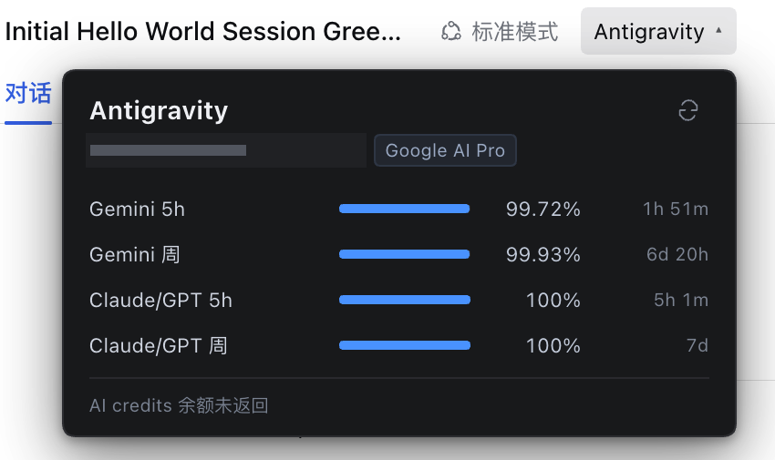

# dsh-agy

dsh-agy 是 DeepSeek Harness 的 Antigravity 协议适配器。服务端授予模型权限后，可以在 Harness 中选择模型、接收流式回复和思考内容，并调用搜索、网页读取或图片生成工具。

这个测试版直接在 Harness 内转换消息、解析流式响应并调用 Google 服务。工具由 Harness 调度。Google OAuth 登录和模型服务分别检查权限，登录成功后仍可能收到模型目录或订阅额度接口的 403。Google 说明第三方编码工具不支持使用 Antigravity 登录。自行注册 OAuth 客户端也不会授予订阅接口访问权。详见 [Antigravity FAQ](https://antigravity.google/docs/faq)。

## 查看剩余额度

在会话标题栏点击 **Antigravity ▾**。面板顶部显示当前账号和套餐，每行依次显示模型组、剩余额度进度条、百分比和距离重置的时间。将鼠标停在倒计时上可以查看具体的重置日期和时间。



打开面板时会查询一次，也可以点击右上角的刷新按钮。下方的 **AI credits 余额** 取自账号服务。服务端明确返回 0 时显示 0，缺少余额字段时显示“未返回”。

在会话中输入 `/antigravity-usage` 可以查看同一份数据的文字版。部分账号只能取得各模型的额度，插件会在共享额度不可用时尝试按模型显示。多个模型可能共用一个额度池。

## 安装 0.2.0-beta.1

需要 Node.js 24.9.0 或更高版本、DeepSeek Harness 0.2.2-rc.5，以及可以使用 Antigravity 的 Google 账号。以下命令均在本仓库根目录运行。仓库名是 `dsh-agy`，Harness 使用的插件包名是 `dsh-antigravity`。

先安装依赖并生成安装包。`npm pack` 会自动构建插件。

```sh
npm ci
npm pack
```

**桌面版**使用应用附带的 `dsh` 命令。正常退出 Harness 后，执行下面的命令安装插件。

```sh
dsh plugin --profile desktop add --config.strict-dep-builds=false "$PWD/dsh-antigravity-0.2.0-beta.1.tgz"
```

**Web 版**使用 `web` 配置安装。

```sh
npx --yes @deepseek-ai/dsh@0.2.2-rc.5 plugin --profile web add "$PWD/dsh-antigravity-0.2.0-beta.1.tgz"
```

### 登录与选择模型

配置你有权使用的 Google 桌面应用 OAuth 客户端，再在源码目录运行登录命令。登录程序会给出 Google 授权网址。登录程序和启动 Harness 的进程都需要能读取同一份 OAuth 配置。

```sh
export ANTIGRAVITY_CLIENT_ID="你的桌面应用 OAuth 客户端 ID"
# 如果该客户端要求密钥，请通过本机环境变量设置 ANTIGRAVITY_CLIENT_SECRET。
npm run login
```

如果 Google 没有自动返回项目，请将环境变量 `ANTIGRAVITY_PROJECT_ID` 设为账号有权访问的实际项目。旧版登录凭据只能用原 OAuth 客户端刷新，换用自己的客户端时需要重新登录。

登录命令与 Harness 需要使用相同的 `DSH_HOME`，默认目录为 `~/.dsh`。如果只有安装包，可以在安装包所在目录运行 `npm exec --yes --package=./dsh-antigravity-0.2.0-beta.1.tgz -- dsh-antigravity-login`。

重新打开桌面应用，或用 `npx --yes @deepseek-ai/dsh@0.2.2-rc.5 web` 启动 Web 版。在会话的模型选择器中打开 **Antigravity**，选择当前账号可用的模型。

## 搜索、网页读取和图片生成

| 工具 | 在会话中可以这样使用 |
| --- | --- |
| `antigravity_search` | “搜索 TypeScript 的最新发布说明，并列出来源。” |
| `antigravity_read_url` | “读取这个公开网页，整理成 Markdown。” |
| `antigravity_generate_image` | “参考项目里的 `references/style.png`，生成一张 16:9 的森林插画。” |

网页正文超过 `maxPageChars`（默认 60,000 字符）时，工具返回节选，并提供会话目录中完整正文的保存路径。图片生成结果作为附件显示在会话里。参考图使用会话工作目录下的相对路径，最多 4 张，每张不超过 10 MB，支持 PNG、JPEG、WebP 和 GIF。

## 开发与许可

安装依赖后运行 `npm run check`，可完成 TypeScript 检查、构建和测试。插件代码位于 `src/`，测试位于 `test/`。

本项目使用 MIT 许可。外部依赖说明见 [第三方许可清单](THIRD_PARTY_NOTICES.md)。[项目许可](LICENSE) · [版本记录](CHANGELOG.md)
